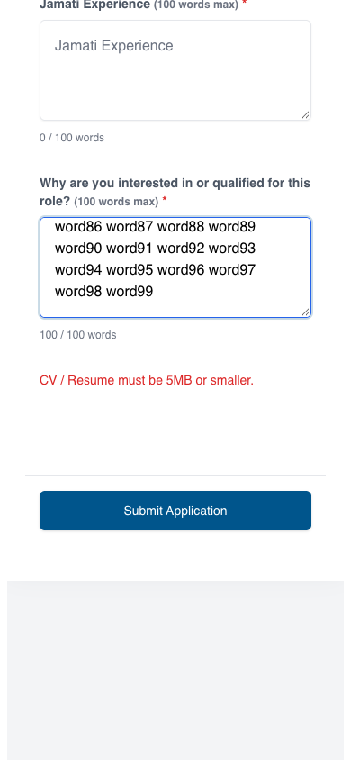
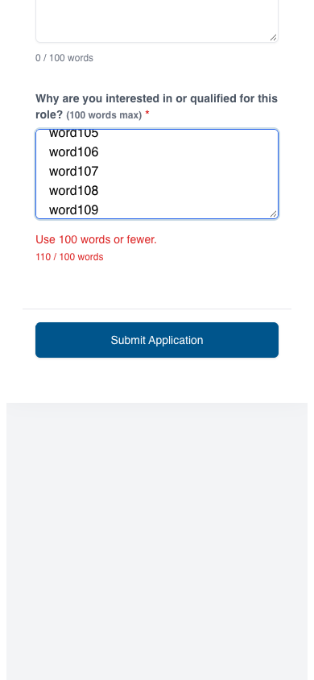

# Application form verification (#46)

The baseline was measured on main commit `f738fe3` before changing the form.
All browser measurements used synthetic jobs/applicant text and intercepted
application responses; no live applications were created.

## Reproduced before fixing

Chrome at 390 × 844, inside a local full-height iframe:

| Check | Before | After |
| --- | --- | --- |
| Mobile progress | 100% at the top; content has no internal scroll | Hidden on mobile; desktop scroll indicator retained |
| Content bottom padding | 96px | 24px |
| Submit footer position | sticky | inline/static |
| Oversized CV error | About 1,250px below the picker, no alert role | 86px below picker after focus settles, announced as an alert |
| Visible fields associated with labels | None | All 13 controls, including the file input |
| Phone input | text, no autocomplete hint | tel, telephone input mode/autocomplete |
| LinkedIn input | text, accepts a plain name | URL input; optional HTTP/HTTPS LinkedIn URL validation |
| Paste of 110 newline-separated words | Silently shortened to 100; newlines removed | All 110 retained, over-limit feedback; submit blocked |

The older upload limit was still 5MB on this branch's baseline. The form continues
to use the shared limit; PR #54 changes it to 4MB independently.

## Screenshots

Same mobile iframe and synthetic over-limit/file-error scenario, near the form
footer. After fixing, the file error belongs next to its picker, and the word
limit feedback belongs next to the answer. These images demonstrate those
intended changes, rather than pixel parity.

| Before | After |
| --- | --- |
|  |  |

## Automated and browser coverage

- Rendered markup tests cover every visible label/control association, phone/email
  autocomplete, mobile footer/progress behavior and desktop progress semantics.
- Client validation tests cover required fields, optional LinkedIn/email feedback,
  missing/oversized files, and 100/101-word boundaries without modifying answers.
- Server tests preserve paragraphs, tabs and indentation for all four long answers,
  normalize CRLF to LF, reject invalid LinkedIn hosts/values, and accept omitted or
  valid LinkedIn URLs. Existing 100-word server enforcement remains enabled.
- Chrome desktop/mobile × standalone/local iframe checks ran against both dev and
  production builds. They exercised label taps, keyboard focus on first invalid
  fields, immediate file error placement, paste retention, submission blocking,
  focused server-error summary, intact failed-submit drafts/files, and retry with
  the same submission key and original multiline answer.

## Manual release check

On a real iPhone in the deployed the.ismaili embed, verify the inline submit button,
keyboard/autofill, file picker, focus/scroll behavior, VoiceOver announcements and
successful submission. The local iframe harness and mobile Chrome emulation do
not verify iOS or the installed production parent script.

No Airtable fields or migrations are needed. Existing returning-applicant profile
update behavior is unchanged. Revert the form, shared helper and validator changes
together if rolling back.
