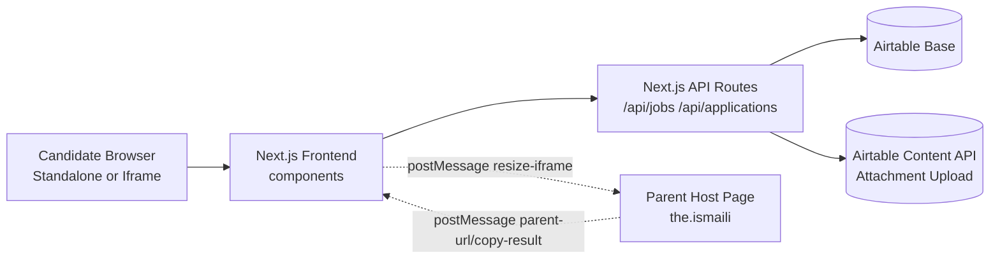

# Architecture Overview

## System Diagram

## Architecture Notes

## Frontend

- Main shell and orchestration: `components/OpportunityBoard.tsx`
- UI components: `components/*`
- Key patterns:
  - job list/details split view
  - in-pane apply flow (replaces modal overlay for iframe reliability)
  - per-job draft preservation for application form
  - URL sync for selected job and view state

## API Layer

Route handlers:
- `GET /api/jobs`
- `POST /api/applications`

Shared integration logic:
- `lib/airtable.ts` (Airtable read/write + attachment upload)
- `lib/api-response.ts` (consistent JSON responses)
- `lib/rate-limit.ts` (request throttling)

## Data Layer

Airtable acts as operational datastore:
- Jobs (GE Roles)
- People
- Applications
- (Recommended extension) Referrals

## Upload Flow

## Primary (current)

Application submission uses multipart form data:
- frontend -> `POST /api/applications`
- backend finds or creates the Person and creates the linked application, or recovers a matching application using its submission key
- backend base64-encodes the file for the Airtable content API and uploads it to the application's `CV / Resume` field when missing
- backend verifies the saved attachment before returning `{ "ok": true }`
- a matching retry resumes a missing upload on the same application

Submission key checks reject conflicting requests, but creation is not atomic across instances. See [submission recovery](submission-recovery.md) for limits and failure handling.

## Hosting / Deployment

- App is built and served as Next.js application
- Embedded use-case:
  - parent page hosts iframe
  - child app adjusts iframe height via `postMessage`
- Operational concerns:
  - cache invalidation after deploys
  - third-party host scripts (GTM/vendor plugins) can introduce console noise unrelated to app code

## Reliability and Security Notes

- Env vars gate Airtable access (`AIRTABLE_*`)
- API routes run server-side (`runtime = nodejs`)
- Application payloads are sanitized/validated before integration calls
- Attachment upload requires existing application record and valid base64 payload
- Application submission supports idempotency key retry safety (`X-Idempotency-Key`)
- Idempotency keys are format-validated before dedupe logic
- Airtable formula inputs are escaped before query construction
- API route includes per-IP rate limiting for abuse resistance
- Iframe parent URL/copy messaging is origin- and source-validated against configured `HOST_ORIGIN` before using redirect/share targets
